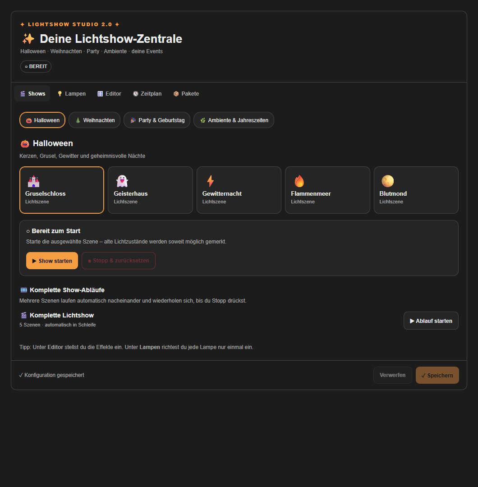

# ✨ Lightshow Studio

Lokale Lichtshows für Home Assistant: Halloween, Weihnachten, Party und Ambiente.
Wiederverwendbare JSON-Pakete, Szenen, Show-Abläufe, jährliche Zeitpläne und eine gemeinsame Lampenzuordnung.
Besondere Unterstützung für Philips Hue Dymera über Zigbee2MQTT, getrennt nach oben/unten.



**Status: 2.0 Beta.** Noch kein vollständiger Laufzeit-/Hardwaretest mit Home Assistant und Dymera.
Native Effekte hängen von Firmware und Gerät ab; andere HA-Lampen erhalten unterstützte Effekte oder ein statisches Fallback.
Keine Musiksynchronisierung. Vor Änderungen ein vollständiges HA-Backup erstellen.

## Installation mit HACS

Voraussetzungen: Home Assistant ab 2024.7 (API-Untergrenze, kein Nachweis aller getesteten Versionen), HACS und eingerichtete MQTT-Integration. Für native Dymera-Effekte Zigbee2MQTT.

1. HACS öffnen → Menü ⋮ → **Benutzerdefinierte Repositories**.
2. `https://github.com/KrOiiDzeR/lightshow-studio` eintragen, Typ **Integration** auswählen und hinzufügen.
3. Lightshow Studio öffnen und herunterladen. Die Beta gegebenenfalls unter **Benötigst du eine andere Version? → Release** auswählen. Für spätere Beta-Updates unter **Einstellungen → Geräte & Dienste → Entitäten** nach Lightshow Studio suchen, auch deaktivierte Entitäten einblenden, die HACS-Entität **Pre-release** aktivieren und anschließend einschalten.
4. In `configuration.yaml` einmal auf oberster Ebene ergänzen:

   ```yaml
   lightshow_studio:
   ```

5. Home Assistant neu starten und Protokolle prüfen.
6. Unter **Einstellungen → Dashboards → Ressourcen** folgende Ressource als **JavaScript-Modul** eintragen:
   `/lightshow_studio/lightshow-studio.js?v=2.0.0-beta.3`
7. Manuelle Dashboard-Karte hinzufügen:

   ```yaml
   type: custom:lightshow-studio
   background: transparent
   ```

HACS installiert Backend und Karte gemeinsam. Es gibt kein zusätzliches Frontend-Repository.
Die YAML-Aktivierung und einmalige Ressourcenregistrierung sind in dieser Beta weiterhin erforderlich.
Die Integration hat noch keinen Einrichtungsdialog unter „Geräte & Dienste“.

## Von der manuellen v2-Beta zu HACS — Einstellungen behalten

1. Laufende Show/Vorschau stoppen und **Speichern** drücken. Vollständiges HA-Backup anlegen; eigene Pakete zusätzlich im Tab **Pakete** exportieren.
2. Den bisherigen Codeordner `custom_components/lightshow_studio/` außerhalb von `custom_components` sichern.
3. Die lokale Datei `.storage/lightshow_studio` erhalten. Dort liegen Lampen, Pakete, Szenen und Zeitpläne. Nicht löschen, nicht bearbeiten und niemals zu GitHub hochladen.
4. Repository in HACS als Integration hinzufügen und herunterladen. HACS darf den bisherigen Codeordner ersetzen. Falls HACS wegen eines vorhandenen Ordners abbricht, HA stoppen, ausschließlich den gesicherten Codeordner aus `custom_components` herausnehmen und den Download erneut durchführen. `.storage` bleibt bestehen.
5. Den bestehenden YAML-Eintrag `lightshow_studio:` genau einmal behalten. Home Assistant neu starten.
6. Die vorhandene Dashboard-Ressource auf die oben genannte URL ändern, keine zweite Ressource mit derselben Karte anlegen. Browser/App vollständig neu laden.
7. Lampenzuordnungen, eigene Pakete und Zeitpläne prüfen, zunächst eine Lampe testen.

Domain `lightshow_studio`, Store-Schlüssel `lightshow_studio` und Speicherformat 2 sind unverändert. Beim Laden vorhandener Daten werden keine neuen Vorgaben darübergeschrieben.
Neue Installationen beginnen mit leerer Lampenliste. Unter **Lampen → +** die eigenen Entitäten zuordnen.
Ein Backup bleibt erforderlich, weil Stromausfälle, beschädigte Daten oder manuelle Eingriffe dadurch nicht ausgeschlossen werden.

### Noch Halloween Control Center v1 installiert?

Vor dem ersten v2-Start den alten YAML-Eintrag `halloween_control_center:` entfernen und konkurrierende Automationen deaktivieren.
Die Datei `.storage/halloween_control_center` erhalten. Wenn noch keine v2-Datei existiert, importiert Studio die v1-Szenen und Zuordnungen einmalig; die v1-Datei bleibt unverändert.
Alte Dashboard-Karte und alte JS-Ressource nach erfolgreicher Prüfung entfernen. `customize.yaml` muss dafür nicht geändert werden.

## Theme und Hintergrund

Standard: transparente Außenfläche ohne Verlauf und Schatten. Innenflächen übernehmen die Kartenfarbe des aktiven HA-Themes; Text, Rahmen und Fehlerhinweise dessen Farben. Event-Akzente bleiben farbig.
Für eine klassische Kartenfläche `background: theme` verwenden. Keine Zusatzkarte und kein card-mod erforderlich.

## Zigbee2MQTT-Erkennung und natives Tempo

Ab beta.3 erkennt Studio die Geräteliste über `+/bridge/devices` automatisch. Der erkannte Topic-Prefix bleibt exakt erhalten; `Zigbee2mqtt` und `zigbee2mqtt` sind unterschiedliche MQTT-Themen.
Unter **Lampen** wird die Anzahl erkannter Geräte angezeigt. **Erkennen** ordnet vorhandene HA-Lampen anhand der Gerätekennung zu. Zuordnungen prüfen und speichern. Je Dymera verwenden oben/unten denselben Gerätenamen und unterschiedliche Lichtbereiche.

Für einen verschachtelten Prefix oder mehrere Bridges mit gleich benannten Geräten kann eine Bridge ausdrücklich gewählt werden:

```yaml
lightshow_studio:
  mqtt_base_topic: home/garden/zigbee
```

Nach einer YAML-Änderung Home Assistant neu starten. Kein Broker-Passwort nötig; Studio verwendet die bestehende MQTT-Integration. Ohne passende Geräteliste bleibt die HA-Steuerung verfügbar. Die Tempo-Einstellung wirkt bei direkt erkannten Dymera-Geräten auf den nativen Effekt; sie beschleunigt keine beliebigen HA-Effekte anderer Lampen.

## Bedienung

- **Lampen:** HA-Entitäten hinzufügen und Rollen Oben/Unten/Haustür/Andere wählen. Für Dymera das Zigbee2MQTT-Gerät und den Endpoint top/bottom zuweisen. Beide Bereiche verwenden dasselbe Gerät.
- **Shows:** Szene oder kompletten Ablauf starten, stoppen und vorherige Lichtzustände bestmöglich wiederherstellen.
- **Editor:** Effekte pro Rolle, Ausnahmen und Abläufe bearbeiten. Änderungen speichern; zunächst eine Lampe für 10 Sekunden testen.
- **Zeitplan:** jährliches Datum und Zeitfenster am selben Tag. Überlappende aktive Termine werden abgelehnt. Schrittwechsel können durch den 5-Sekunden-Prüfzyklus verzögert sein.
- **Pakete:** JSON importieren/exportieren oder vorhandenes Paket kopieren. Beispiel: `show_packs/Sommerparty.json`.

Aktionen für Automationen:

```yaml
action: lightshow_studio.start
data:
  pack_id: halloween
  scene_id: castle
```

Weitere Aktionen: `lightshow_studio.start_program` mit `pack_id` und `program_id`; `lightshow_studio.stop` ohne Daten.

## Updates und Rückkehr zur vorherigen Version

Neue veröffentlichte Versionen erscheinen über HACS; je nach HACS-Version auch als Update in Home Assistant.
Update installieren, HA neu starten und den Browser neu laden. Falls die Karte veraltet bleibt, den `?v=`-Wert der bestehenden Ressource auf die neue Version setzen.
Beta-Updates setzen die Auswahl von Vorabversionen voraus. Eine Aufnahme in die HACS-Standardliste ist ein gesonderter Vorgang; dieses Repository wird zunächst benutzerdefiniert hinzugefügt.

Bei Problemen die vorherige Version im HACS-Download-Dialog auswählen oder den gesicherten Code zurückspielen, danach neu starten. Bei künftig geändertem Speicherformat auch das passende Backup wiederherstellen.

## Einschränkungen und Fehlersuche

- Vorherige Zustände werden nur bestmöglich wiederhergestellt. Neustarts während einer Show verlieren flüchtige Snapshots; dann Lampen manuell prüfen.
- Bei „Custom element doesn't exist“ Ressourcen-URL, Modultyp, HA-Protokoll und Browsercache prüfen.
- Bei fehlenden Effekten Entität, MQTT, Zigbee2MQTT-Gerätenamen, Dymera-Modell `046677585235` und Endpoint prüfen.
- Administrationsrechte in HA sind für die Konfiguration erforderlich. Keine Zugangsdaten oder Cloud-Dienste nötig.
- Keine HA-Konfigurationen, Backups, Geräteadressen oder Tokens in Issues anhängen; Beispiele vorher anonymisieren.

## Entwicklung und Releases

Siehe [Release-Anleitung](docs/RELEASING.md) und [Prüfstatus](docs/VALIDATION.md).
Lizenz: MIT. Nicht Teil des offiziellen Home-Assistant-Projekts.

Konventionen: [HACS Integration](https://www.hacs.xyz/docs/publish/integration/), [HACS Versionierung](https://www.hacs.xyz/docs/publish/start/), [HACS Action](https://www.hacs.xyz/docs/publish/action/).
