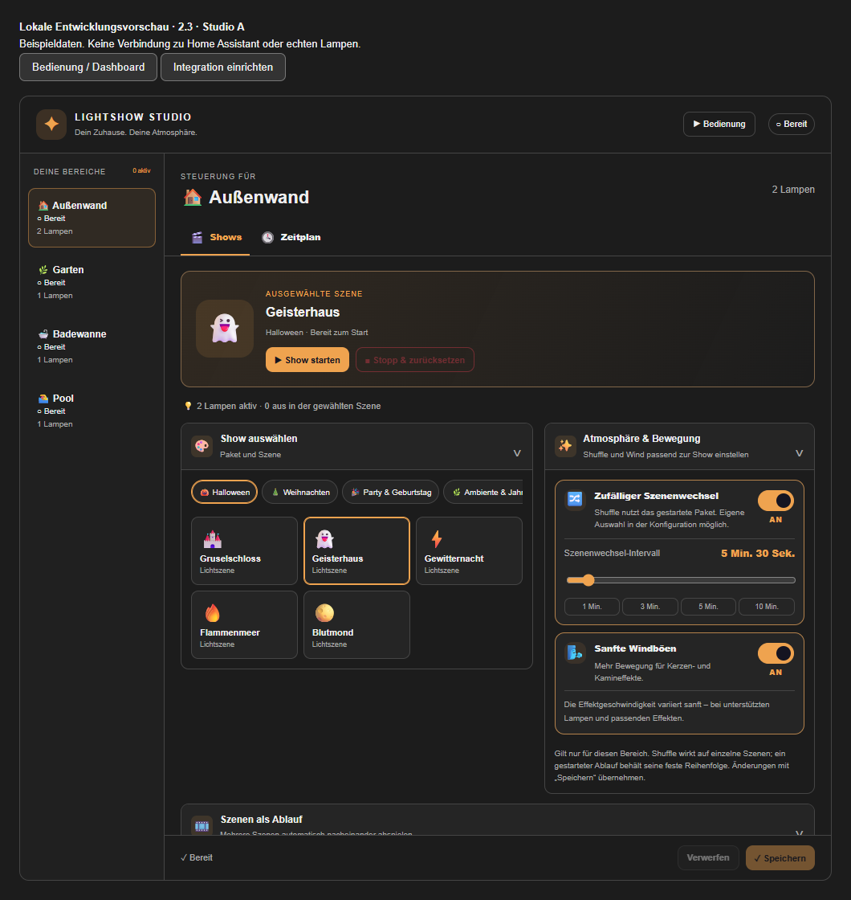
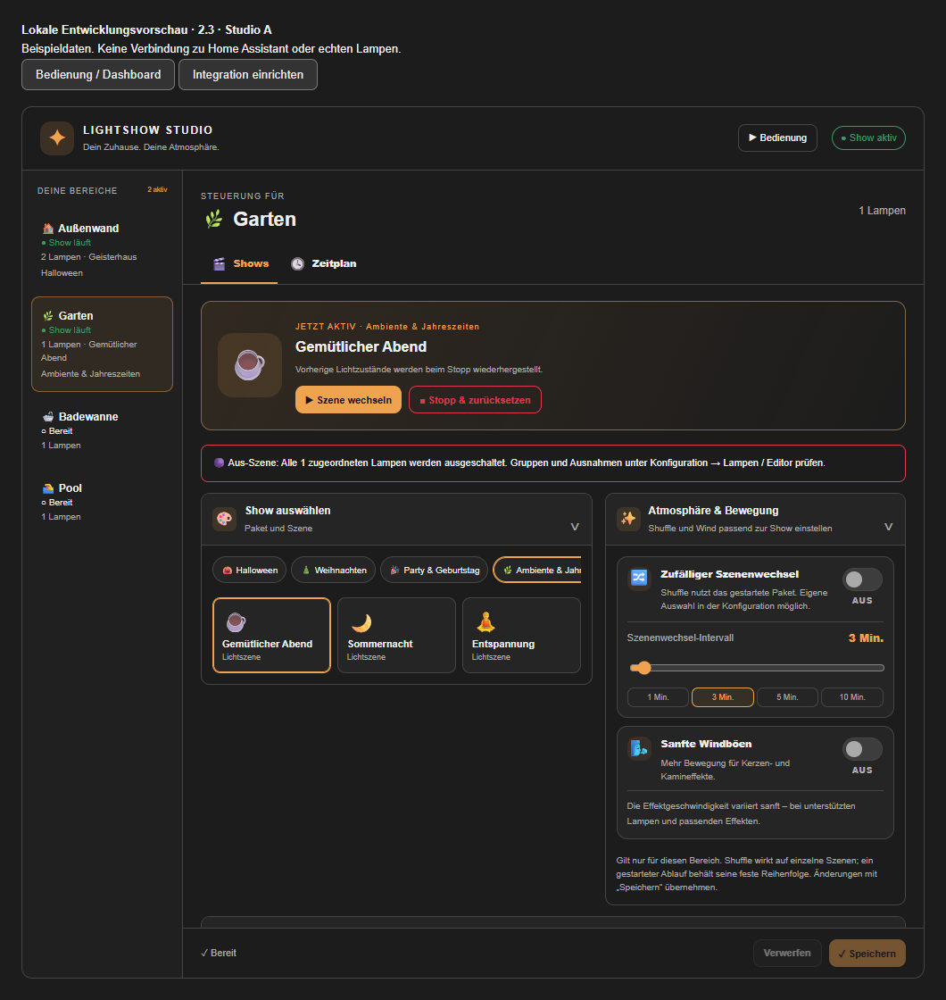

# ✨ Lightshow Studio

> **Neu in 2.3.1-beta.1:** Klare Szenenzuordnung, Schaltaktoren als Lampen und ein ausblendbarer Seitenleisteneintrag. [Änderungen, Hardwaretests und Logo-Hinweis](docs/TEST-2.3.1.md).

> **Neu in 2.2:** gemischte Lampenquellen, Favoriten, gemeinsame Bereichssteuerung, Timer, Shuffle-Runden, Bereichskopie und sanfte Übergänge. [Bedienung und Teststatus](docs/TEST-2.2.md).

Lokale Lichtshows für Home Assistant: Halloween, Weihnachten, Party und Ambiente.
Szenen, JSON-Pakete, Show-Abläufe, Shuffle, Wind, Jahreszeiten und Wochenprogramm.
Philips Hue Dymera wird über Zigbee2MQTT getrennt nach oben/unten unterstützt.

**Version 2.3.1-beta.1.** Einrichtung vollständig über die Home-Assistant-Oberfläche; keine neuen YAML-Einträge und keine manuelle JavaScript-Ressource erforderlich.
Voraussetzungen: Home Assistant **2026.10 oder neuer**, HACS und für native Dymera-Steuerung eine eingerichtete MQTT-/Zigbee2MQTT-Anbindung.
Die Integration bleibt eine Beta. Automatische Prüfungen und Browserprüfungen mit Beispieldaten ersetzen keinen vollständigen Hardwaretest; den genauen Stand dokumentiert [VALIDATION.md](docs/VALIDATION.md).



## Alle Home-Assistant-Lampen verwenden

Unter **Konfiguration → Lampen → Lampenquelle** zwischen **Home Assistant** und **Zigbee2MQTT** wählen. Home Assistant enthält alle verfügbaren `light.*`-Entitäten, einschließlich Shelly-/WLAN-Leuchten mit RGB, RGBW oder RGBWW. Diese Anbindung benötigt keine direkte MQTT-Verbindung und bleibt auch bei automatischer Erkennung ausdrücklich auf HA gestellt. Beide Anbindungen dürfen im selben Bereich vorkommen. Die Zigbee2MQTT-Auswahl zeigt erkannte, mit HA-Lichtentitäten verbundene Lampen; native Dymera-Effekte bleiben direkt, andere Z2M-Leuchten verwenden HA. Fähigkeiten und Anbindung werden pro Lampe angezeigt.

Leuchten, die HA als `switch.*` bereitstellt, unter **Lampenquelle → Schaltaktor als Lampe (Ein/Aus)** ausdrücklich auswählen. Sie erhalten ausschließlich Schaltbefehle. Neue normale Lampen beginnen in der aktiven Gruppe **Hauptlicht / Oben**. Bei älteren Einrichtungen die Gruppenzuordnung prüfen: Eine gespeicherte Aus-Spur wird weiterhin ausgeschaltet; die Oberfläche zeigt dies jetzt vor dem Start an.

Unter **Konfiguration → Verbindung** lässt sich der Seitenleisteneintrag mit einem kleinen Schalter global ein- oder ausblenden.

## Neue Bedienfunktionen

Im Dashboard Szenen als **Favoriten** merken und direkt starten, mehrere **Bereiche gemeinsam bedienen** oder nach dem Start einen **Ausschalt-Timer** setzen. Unter Übergänge & Shuffle-Runden lassen sich **0–30 Sekunden Überblendung** und **Shuffle ohne Wiederholungen** einstellen. Bereiche werden im Konfigurationsbereich **kopiert**; die Kopie beginnt ohne Lampenzuordnung und mit deaktivierten Zeitplänen. Einzelheiten und Grenzen: [2.2-Anleitung](docs/TEST-2.2.md).

## Unabhängige Bereiche und parallele Shows

Unter **Integration → Konfiguration → Bereiche → Bereich anlegen** beispielsweise Außenwand, Garten, Badewanne und Pool hinzufügen.
Name und Symbol im eingebauten Formular eingeben und **Bereich erstellen** drücken (oder die Eingabetaste). Dafür sind keine Browser-Pop-ups erforderlich. **Abbrechen** verwirft das neue Formular, ohne einen Bereich anzulegen.
Oben den gewünschten Bereich wählen und anschließend unter **Lampen**, **Editor** und **Pakete** dessen eigene Einrichtung festlegen.
Jeder neue Bereich beginnt mit einer leeren Lampenliste und eigenen Kopien der eingebauten Pakete.
Bearbeitete Szenen, Abläufe, importierte Pakete, Shuffle/Wind und Zeitpläne gelten ausschließlich für den gewählten Bereich.
Bis zu 30 Bereiche sind möglich; der MQTT-Anschluss bleibt gemeinsam.

Das Dashboard zeigt pro Bereich Bereitschaft, laufende Show oder Vorschau, Lampenanzahl, Paket und Szene/Ablauf sowie Hinweise.
Bereich anklicken, Szene oder Ablauf wählen und starten. Andere Bereiche laufen unabhängig weiter.
**Stopp & zurücksetzen** betrifft im Dashboard immer den ausgewählten Bereich.
Die Bereichsauswahl merkt sich die zuletzt ausgewählte Szene innerhalb der geöffneten Karte.

Eine HA-Lichtentität darf nur einem Bereich zugeordnet sein, auch wenn sie dort deaktiviert ist.
Das verhindert konkurrierende Steuerung und unzuverlässiges Rücksetzen derselben Entität.
Zum Verschieben die Lampe im bisherigen Bereich entfernen und speichern, anschließend im anderen Bereich hinzufügen.
Unterschiedliche HA-Gruppen können dieselben physischen Lampen enthalten; solche indirekten Überschneidungen werden nicht automatisch erkannt.

Die vollständige Sicherung unter **Pakete** enthält alle Bereiche. Ein v2-Einzelexport kann weiterhin im gewählten Bereich wiederhergestellt werden.
Eine vollständige Bereichssicherung ersetzt beim Speichern alle Bereiche und erfordert, dass alle Shows/Vorschauen beendet sind.
Laufende Bereiche können nicht gelöscht werden; der letzte Bereich bleibt immer erhalten.



## Einrichtung und Bedienung

| Bereich | Funktionen |
| --- | --- |
| Integration → Konfiguration | Bereiche anlegen/benennen/löschen, Zigbee2MQTT-Anbindung, Lampen suchen/zuordnen, Gruppen und Dymera-Bereiche |
| Integration → Konfiguration | Szenen, Effekte, Ausnahmen, Show-Abläufe bearbeiten und testen |
| Integration → Konfiguration | Pakete kopieren/importieren/exportieren, vollständige Einrichtung sichern/wiederherstellen |
| Dashboard / Lightshow Studio | Paket und Szene auswählen, Show oder Ablauf starten, stoppen und Lichtzustände wiederherstellen |
| Dashboard / Lightshow Studio | Shuffle und Wind, jährliche Events sowie Wochenprogramm |

Der Dashboard-Karte kann kein Konfigurationsmodus per YAML eingeschaltet werden.
Die Konfigurationsansicht ist ein eigener, administrativer Home-Assistant-Bereich.
Konfiguration und Bedienung erfordern aktuell ein HA-Administratorkonto.

## Installation mit HACS – ohne Konfigurationsdateien

1. In HACS **Menü → Benutzerdefinierte Repositories** öffnen und `https://github.com/KrOiiDzeR/lightshow-studio` als Typ **Integration** hinzufügen.
2. **Lightshow Studio** öffnen und `v2.3.1-beta.1` herunterladen. Falls nötig im Versionsdialog Vorabversionen auswählen. Für spätere Beta-Updates die von HACS bereitgestellte **Pre-release**-Entität aktivieren und einschalten.
3. Home Assistant neu starten.
4. **Einstellungen → Geräte & Dienste → Integration hinzufügen → Lightshow Studio** öffnen.
5. Zigbee2MQTT-Erkennung auswählen: automatisch, eigene Bridge oder nur HA-Lampen. Ohne direkte MQTT-Anbindung stehen unterstützte Funktionen vorhandener HA-Lichtentitäten zur Verfügung.
6. Auf der Integrationsseite **Konfiguration** öffnen. Alternativ im Optionen-Dialog den Link **Lampen, Szenen und Pakete konfigurieren** oder beim Studio-Gerät die Konfigurationsseite öffnen.
7. Bereiche anlegen, HA-Lichtentitäten auswählen, Rollen und gegebenenfalls Zigbee2MQTT-Geräte/Bereiche zuordnen. **Erkennen** übernimmt passende Gerätezuordnungen; anschließend kontrollieren und speichern.
8. Der Seitenleisteneintrag **Lightshow Studio** bietet sofort die Bedienung an. Für ein vorhandenes Dashboard im Kartenwähler **Lightshow Studio** hinzufügen. Die Karte wird automatisch geladen.

Kein Eintrag in `configuration.yaml`, keine manuelle Ressourcenregistrierung, keine Zusatzkarte und kein card-mod erforderlich.
HACS installiert Backend und Karte gemeinsam. Das Repository wird weiterhin als benutzerdefiniertes Repository hinzugefügt; eine Aufnahme in die HACS-Standardliste ist ein gesonderter Vorgang.

## Zigbee2MQTT individuell einstellen

Die zentrale MQTT-Integration von Home Assistant verwaltet Broker, Port und Zugangsdaten.
Diese können über deren normale Einrichtungsoberfläche konfiguriert werden; Studio verlinkt sie direkt.
Studio speichert keine zweite Broker-Verbindung und keine Broker-Zugangsdaten.

- **Automatisch:** Gerätelisten über `+/bridge/devices`; die Schreibweise des erkannten Basisthemas bleibt erhalten.
- **Eigene Bridge:** Exaktes, auch verschachteltes Basisthema eingeben, beispielsweise `home/garden/zigbee`. Kein `/bridge/devices` anhängen; keine MQTT-Platzhalter verwenden.
- **Nur Home-Assistant-Lampen:** Keine direkte MQTT-Teilnahme. Vorhandene `light.*`-Entitäten lassen sich mit ihren unterstützten Funktionen verwenden.

Nach dem Übernehmen der Verbindung lädt Home Assistant die Integration neu. Laufende Shows oder Vorschauen vorher stoppen.
Bei gleichnamigen Geräten mehrerer Bridges ausdrücklich eine Bridge wählen; mehrdeutige MQTT-Befehle werden abgelehnt.
Für Dymera oben/unten zwei HA-Entitäten mit demselben Zigbee2MQTT-Gerätenamen und unterschiedlichen Bereichen zuordnen.
Natives Tempo setzt ein unterstütztes Gerät und passende Firmware voraus.

## Eigene Szenenauswahl für Shuffle

Unter **Integration einrichten → Bereich wählen → Shuffle** werden alle Szenen dieses Bereichs nach Paketen aufgelistet.
Über die Schalter einzelne Szenen aufnehmen oder ausschließen, anschließend **Speichern** drücken. Szenen aus unterschiedlichen Paketen können kombiniert werden.
**Alle Szenen aufnehmen** und **Auswahl leeren** helfen bei der Zusammenstellung. Jeder Bereich hat eine eigene Auswahl.
Neue oder importierte Szenen werden einer bereits festgelegten Auswahl nicht automatisch hinzugefügt.

Im Dashboard wird Shuffle eingeschaltet und das Wechselintervall eingestellt. Dort erscheint auch die Anzahl der ausgewählten Szenen.
Eine leere Auswahl führt zu keinem zufälligen Wechsel. Bei nur einer ausgewählten Szene bleibt diese nach Erreichen aktiv.
Standardmäßig werden erst alle ausgewählten Szenen einmal gespielt und anschließend neu gemischt. Auch an der Rundengrenze wird die unmittelbar letzte Szene nicht sofort wiederholt. Im Dashboard kann dieses Rundenverhalten abgeschaltet werden. Feste Show-Abläufe behalten ihre Reihenfolge.
Die Auswahl wird wie andere Konfigurationsänderungen erst nach Stoppen des Bereichs gespeichert.
Solange noch keine eigene Auswahl gespeichert wurde, verwendet Shuffle wie bisher die Szenen des gestarteten Pakets.

## Wochenprogramm und Jahres-Events

Unter **Zeitplan** Wochentage, Beginn, Ende, Paket und Szene oder kompletten Ablauf wählen.
Neue Wochenzeiten sind deaktiviert. Erst nach Aktivierung und Speichern laufen sie automatisch.
Überlappende aktive Wochenzeiten werden abgelehnt; angrenzende Zeitfenster sind erlaubt.
Jährliche Events haben während ihres Zeitfensters Vorrang, danach kann ein Wochenprogramm fortgesetzt werden.
Alle Zeiten verwenden Home Assistants lokale Zeitzone. Fenster müssen am selben Tag enden.
Der Prüftakt beträgt fünf Sekunden. Nach einem manuellen Stopp erfolgt an diesem Tag kein automatischer Neustart.
Manuell gestartete Shows werden nicht durch einen Zeitplan beendet.

## Bestehende v2-Einrichtung erhalten

Vor dem Update alle Shows/Vorschauen stoppen und ein vollständiges HA-Backup anlegen. Eigene Pakete zusätzlich exportieren.
Dann die neue Version in HACS installieren, Home Assistant neu starten und den Browser vollständig neu laden.
Bei einer bestehenden YAML-Installation nicht zusätzlich einen zweiten Eintrag anlegen: der Import startet automatisch. Bei einer frischen Installation den oben beschriebenen Einrichtungsdialog verwenden.
Die Domain und der Speicherpfad `.storage/lightshow_studio` bleiben erhalten.
Bestehende v2-Lampen, Pakete, Szenen, Abläufe und Termine werden vollständig in den ersten Bereich **Mein Bereich** übernommen; dieser kann umbenannt werden.
Beim Laden wird die bisherige Datei nicht überschrieben. Erst beim nächsten Speichern entsteht der Bereichscontainer mit Schema 3, dessen einzelne Bereichseinstellungen weiterhin Schema 2 verwenden.
Die HA-Store-Version bleibt 2. Vor einem Downgrade auf 2.0.0-beta.3 die vor dem Update erstellte Sicherung wiederherstellen, da diese Version noch keinen Bereichscontainer versteht.

Der bisherige YAML-Eintrag wird beim Start automatisch in genau einen UI-Eintrag importiert.
Ein vorhandener UI-Eintrag verhindert doppelte Einrichtung. Das alte YAML darf zunächst bleiben und muss für das Update nicht manuell geändert werden.
Die bislang vorhandene Dashboard-Karte verwendet automatisch die Bedienungsansicht.
Ihre bisherige Ressourcen-URL liefert nach Austausch des Codes ebenfalls den neuen Code; eine zweite Registrierung ist nicht nötig.

Die v1-Datei `.storage/halloween_control_center` bleibt unverändert. Ist noch keine v2-Datei vorhanden, werden gültige v1-Szenen einmalig übernommen.
Konkurrierende alte Automationen vor einem tatsächlichen Test deaktivieren.
Niemals `.storage`, Konfigurationsexporte, HA-Konfigurationsdateien oder Zugangsdaten zu GitHub hochladen.

## Oberfläche

Der transparente Hintergrund und die Home-Assistant-Themefarben bleiben erhalten.
Zusammengehörige Funktionen sind als aufklappbare Abschnitte mit Symbol, Titel und eigener Umrandung gegliedert. Ein Klick auf die Abschnittsüberschrift klappt den Inhalt ein oder aus; dieser Zustand bleibt innerhalb der geöffneten Karte bei Aktualisierungen erhalten.
Die Ansichtsreiter zeigen Titel und Zweck sowie eine deutliche aktive Markierung. Sie lassen sich auch mit Pfeiltasten, Pos1 und Ende wechseln.
Shuffle und Wind haben gestaltete Schalterkarten. Für das Szenenwechselintervall stehen ein Regler und Vorgaben für 1, 3, 5 und 10 Minuten zur Verfügung. Änderungen werden wie bisher mit **Speichern** übernommen.
Die Option `background: theme` bietet alternativ eine normale Kartenfläche.
Die vorhandenen Effekte, Pakete, Gruppen, Einzel-Ausnahmen und Abläufe bleiben verfügbar.
Der Konfigurationsbereich enthält weiterhin die zehnsekündige Einzelvorschau.

## Lokale Entwicklung und Prüfungen

Siehe [Entwicklungsstand](docs/DEVELOPMENT.md), [Prüfstatus](docs/VALIDATION.md) und [Release-Verfahren](docs/RELEASING.md).
Die Datei [dev-preview.html](docs/dev-preview.html) ist eine vollständig lokale, interaktive Vorschau mit Beispieldaten.
Sie steuert keine echten Lampen und benötigt weder Home Assistant noch ein Benutzerkonto.
Änderungen der Vorschau gelten für die geöffnete Sitzung; beim vollständigen Neuladen startet sie wieder mit Beispieldaten. Die tatsächliche Integration speichert Bereiche dauerhaft in Home Assistant.

```text
python scripts/check_repository.py
python -m unittest discover -s tests -v
node --check custom_components/lightshow_studio/static/lightshow-studio.js
node tests/ui_smoke.cjs
python scripts/build_release.py
```

Native Home-Assistant-Einrichtung, Bereichssteuerung und Migration dieser Beta sind noch nicht vollständig auf realer Hardware geprüft.
Die bereits erfolgten realen beta.3-Tests ersetzen diese neue Prüfung nicht.

Lizenz: MIT. Keine Cloud-Anbindung und keine Musiksynchronisierung.
